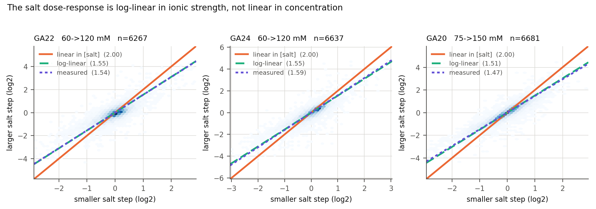
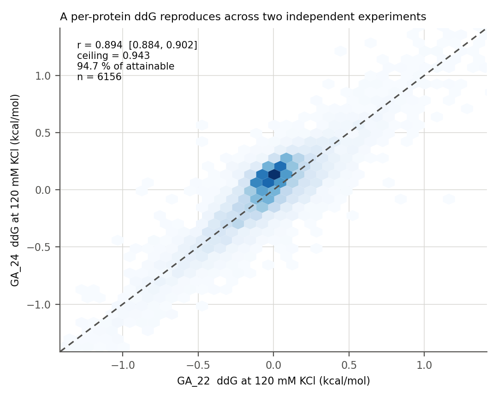
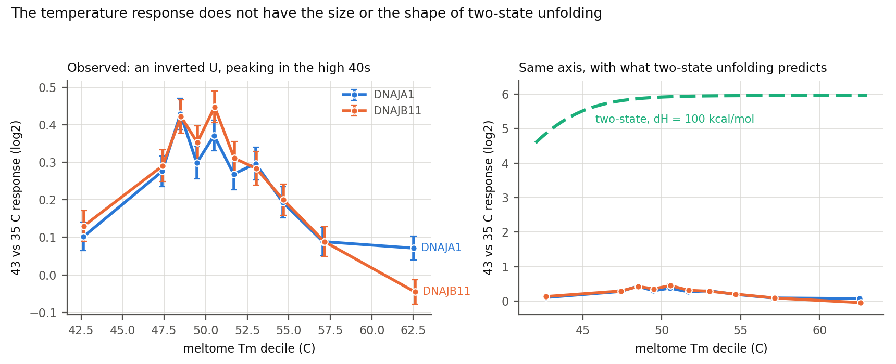
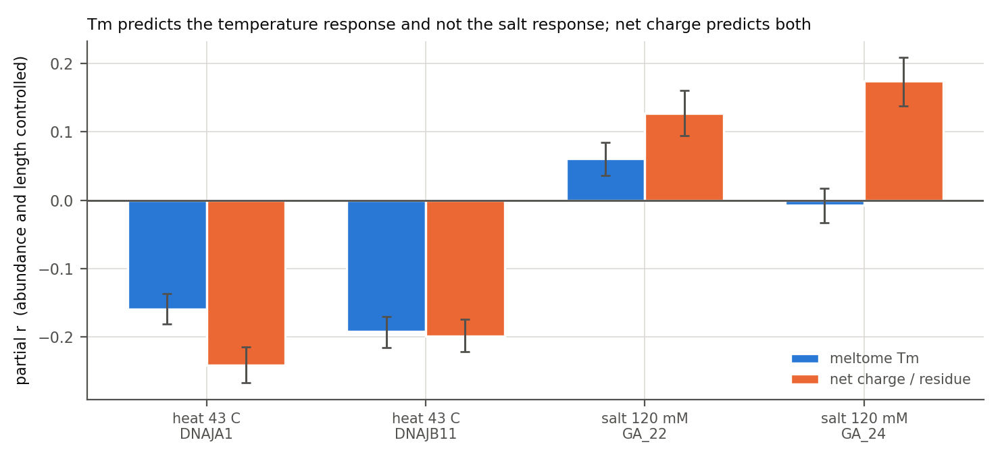
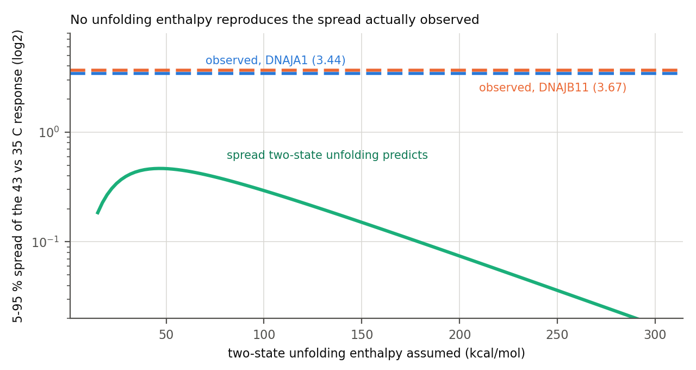

# 1. The theory

A pull-down is a partition. Each protein *i*, in each condition *c*, is divided between a bead-bound pool
and a free pool, and both pools are measured: the IP gives the bound side, the post-IP supernatant gives
the free side. Their log ratio is a binding constant,

$$\log_2 K_{i,c} = \mathrm{part}_{i,c} + C_c , \qquad \mathrm{part} = \mathrm{ip} - \mathrm{sup},$$

where $C_c$ is a single per-condition constant absorbing the free bait concentration, the bead capacity,
and the fact that the IP and supernatant runs were median-normalised separately. The free energy follows:

$$\Delta G_{i,c} = -RT\ln 2 \;\bigl(\mathrm{part}_{i,c} + C_c\bigr).$$

$C_c$ is not measured, so **absolute $\Delta G$ is unobtainable**. In a contrast between two conditions it
collapses to one number shared by every protein,

$$\Delta\Delta G_i (c \to c') = -RT\ln 2\;\bigl[(\mathrm{part}_{i,c'} - \mathrm{part}_{i,c}) + (C_{c'}-C_c)\bigr],$$

so **a per-protein $\Delta\Delta G$ is determined up to a single additive constant per contrast**, and
*differences between proteins* are fully determined. The conversion is $RT\ln 2$ per log2 unit: 0.4245
kcal/mol at 35 °C, 0.4272 at 37 °C, 0.4355 at 43 °C. For temperature, van 't Hoff
($\mathrm{d}\ln K/\mathrm{d}(1/T) = -\Delta H/R$) makes one log2 unit of change across 35 → 43 °C equal to
an apparent $\Delta H$ of **16.8 kcal/mol**.

Three conditions have to hold for this to be physics rather than bookkeeping: the perturbation must act
during binding rather than only during the wash; the bait must not deplete the client, so that free ≈
total; and the dose-response must take the form the underlying physics dictates. The first is now settled
for the salt series — the lab confirms salt is present in the incubation.

A further step would read **stability**: if the chaperone binds exposed or unfolded state, then
bound $\propto f_u$, and while the native state dominates, $\log_2 f_u \approx -\Delta G_{unf}/RT\ln 2$, so
enrichment would be a linear readout of stability. Section 3 rejects this step.

# 2. What can be proven

**The partition is a property of the protein, not of the experiment.** GA_22 and GA_24 are independent
experiments — separate lysates, separate MS runs, different cofactor arms — sharing only the bait and the
salt points. Their per-protein $\Delta\Delta G$ at 120 mM KCl agree at **r = 0.894** [0.884, 0.902],
n = 6156, against a maximum attainable $\sqrt{c_1c_2} = 0.943$ set by the two reliabilities. That is
**94.7 % of the attainable correlation** (Figure 2). Whatever the quantity is, it is reproducible and
protein-specific.

**The precision is sufficient to rank proteins.**

| Contrast | ceiling | 5–95 % spread (kcal/mol) | per-protein noise (kcal/mol) |
|---|---:|---:|---:|
| GA22 part, 60 mM | 0.871 | 0.814 | 0.092 |
| GA22 part, 120 mM | 0.924 | 1.146 | 0.099 |
| GA24 part, 60 mM | 0.909 | 0.812 | 0.078 |
| GA24 part, 120 mM | 0.963 | 1.165 | 0.074 |

**The dose-response has the form the theory requires.** Regressing the larger salt step on the smaller one
per protein, with an errors-in-variables (Deming) slope so that noise in the smaller step does not
attenuate it:

| Run | steps | measured slope | linear in [salt] | log-linear in ionic strength |
|---|---|---:|---:|---:|
| GA_22 part | 60 → 120 mM | **1.544** [1.502, 1.590] | 2.00 | 1.55 |
| GA_24 part | 60 → 120 mM | **1.589** [1.551, 1.635] | 2.00 | 1.55 |
| GA_20 ip | 75 → 150 mM | **1.472** [1.448, 1.499] | 2.00 | 1.51 |

Linear dependence on concentration is excluded in all three. The log-linear prediction is the
Record–Lohman form for release of electrostatic ion pairs, and GA_20 — at different concentrations from
the other two — lands on its own prediction (Figure 1). One caveat: the prediction assumes a 50 mM
buffer contribution to ionic strength; across a plausible 25–100 mM range it moves between 1.44 and 1.68,
so these data fix the functional form but not the buffer floor.

**The bait does not deplete the client.** If salt merely stripped protein off the beads, that material
would reappear in the supernatant and the two contrasts would be negatively correlated. The measured slope
of the supernatant contrast on the IP contrast is **+0.15** (GA_22) and **+0.07** (GA_24) — not negative.
Free ≈ total, which is the regime the derivation assumes.

**The temperature response contains a real and specific thermodynamic component.** Partial correlation of
the 43 vs 35 °C response with meltome $T_m$, controlling lysate abundance and length, cluster-bootstrapped
over the 30 % identity groups: **−0.159** [−0.181, −0.136] for DNAJA1 and **−0.192** [−0.215, −0.170] for
DNAJB11. It survives net charge in a joint model ($\beta_{T_m}$ = −0.185 and −0.235, both intervals
excluding zero). Critically it is *specific*: $T_m$ does not predict the salt response (+0.061 in GA_22,
−0.007 in GA_24 — inconsistent in sign between two runs of the same contrast), which is what a genuine
stability term should look like and what a generic covariate should not (Figure 4).

# 3. What can be discounted

**The temperature response is not two-state unfolding.** Three independent arguments, all framed on
*spreads* rather than levels, because per-sample median normalisation forces the median response to zero
and makes absolute response levels uninterpretable.

*Scale.* Below the transition the predicted response does not depend on $T_m$ at all — at
$\Delta H$ = 100 kcal/mol it is 5.52, 5.87, 5.94 and 5.96 log2 units for $T_m$ = 45, 48.5, 52 and 57 °C.
The model therefore predicts almost no protein-to-protein variation. Observed 5–95 % spread is **3.44**
log2; the largest the model can produce, maximised over every enthalpy from 15 to 300 kcal/mol, is **0.47**
log2 at $\Delta H$ = 46 — a **7.4-fold shortfall**, and no choice of enthalpy closes it (Figure 5).

*Correlation.* The explicit two-state predictor — log2 of the unfolded-fraction ratio between 43 and 35 °C,
computed from each protein's own $T_m$ — correlates with the data at r = −0.005 to +0.044, which is worse
than a plain linear $T_m$ term.

*Shape.* The observed response is an inverted U in $T_m$, rising to a peak in the high 40s and falling away
on both sides. Two-state unfolding predicts a monotone saturating curve (Figure 3).

The stability signal established in Section 2 is therefore real but minor — it accounts for roughly 3 % of
the variance in the temperature response — and the bulk of that response is something else.

**The current temperature range cannot measure $T_m$, even with perfect data.** This follows from the same
flatness. Between 35 and 43 °C every protein melting above about 45 °C is native-dominant, and in that
regime the response reports $\Delta H$ and is *independent of* $T_m$. $T_m$ only becomes observable once
the transition is crossed. This is a property of the experimental design, not of measurement quality, and
no amount of replication or MS time will recover it.

**Net charge is not evidence of ion-pair release.** Charge does predict the salt response, consistently in
sign across both runs (+0.127 in GA_22, +0.174 in GA_24). But it predicts the *temperature* response at
least as strongly (−0.241 and −0.199), where ion-pair release is irrelevant. It fails the specificity test
that $T_m$ passed, and is best read as a generic compositional covariate. The electrostatic argument rests
on the log-linear dose-response alone, which does not depend on charge.

# 4. What these data cannot decide

**Absolute $\Delta G$.** $C_c$ was removed deliberately by median normalisation. Every number here is
relative to the median protein. A spike-in standard, or a reference set assumed invariant, would restore it.

**Whether the binding is to the bait or to the resin.** No experiment includes a bait-free IP. A
charge-dependent, salt-reversible interaction is exactly as consistent with a charged resin as with HSPB1,
and nothing in this dataset separates them.

**Whether the bait is limiting.** In the joint model, lysate abundance carries the *largest* coefficient
(+0.344 and +0.374) — larger than $T_m$ or charge — in a within-protein contrast where abundance ought to
have cancelled. That is either a dynamic-range artefact or real competition for a limited bait, and the
difference matters: under competition every $\Delta\Delta G$ is compressed by an unknown factor.

**Whether the wash is at the incubation salt.** If the washes run at a common salt instead, the measured
$\Delta\Delta G$ carries an off-rate term of the same sign as the equilibrium term, making it an upper
bound rather than an estimate.

**Whether a subunit's $\Delta\Delta G$ is its own.** Residuals are shared within Complex Portal complexes,
so for a subunit the quantity may belong to the assembly.

# 5. What follows

The salt $\Delta\Delta G$ is usable now, as a per-protein quantity, on the strength of Section 2 — it
reproduces across independent experiments at 95 % of the attainable limit, it has the precision to rank
proteins, and its dose-response has the right functional form. It should be reported as a $\Delta\Delta G$
relative to the median protein, never as an absolute binding energy.

The temperature $\Delta\Delta G$ should be reported as an *apparent* $\Delta\Delta G$ and not as a
stability. The stability component is real and specific but small, and the dominant part of the signal has
neither the magnitude nor the shape of unfolding.

Four experiments resolve the four open items, in priority order:

| Experiment | Resolves |
|---|---|
| Bait-free IP at every salt point | bait vs resin — the one fraction no experiment has |
| Bait titration at 0.25 / 1 / 4× | whether the bait is limiting, and so whether $\Delta\Delta G$ is compressed |
| Temperature 40–60 °C in 4 °C steps | crosses the transition; the only route to a per-protein $T_m$ |
| A spike-in standard | restores $C_c$, and with it absolute $\Delta G$ |

The temperature recommendation is worth separating from the earlier argument that the 2 °C step was simply
too small. That argument was about precision. The argument here is about identifiability: within 35–43 °C
the response is mathematically insensitive to $T_m$, so no per-protein stability exists to be measured in
this window at any precision.

---

*Numbers: `data/campaign/cm27_free_energy.json`. Analysis: `code/cm27_free_energy.py`. Figures:
`reports/figures/dg/`. Intervals are 95 % cluster bootstraps over the 30 % identity groups used to build
the held-out folds.*

