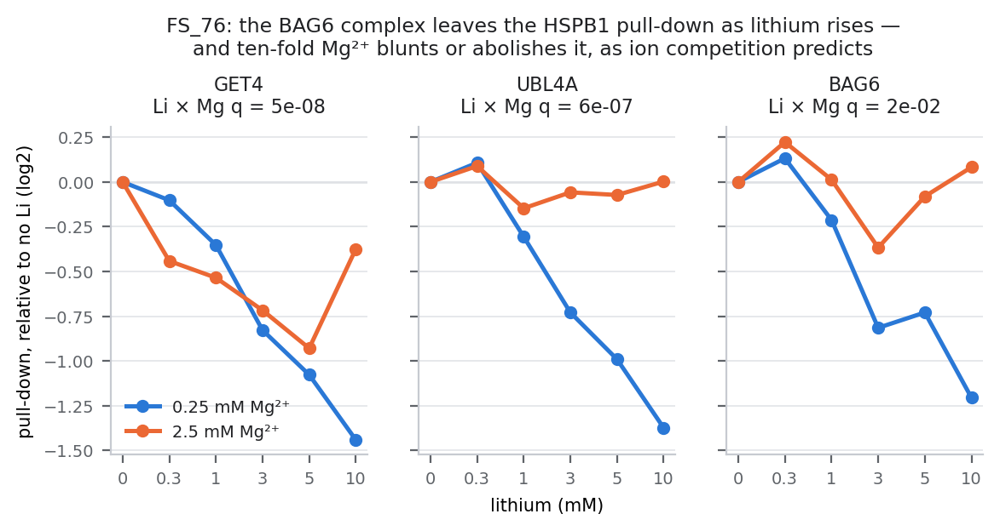
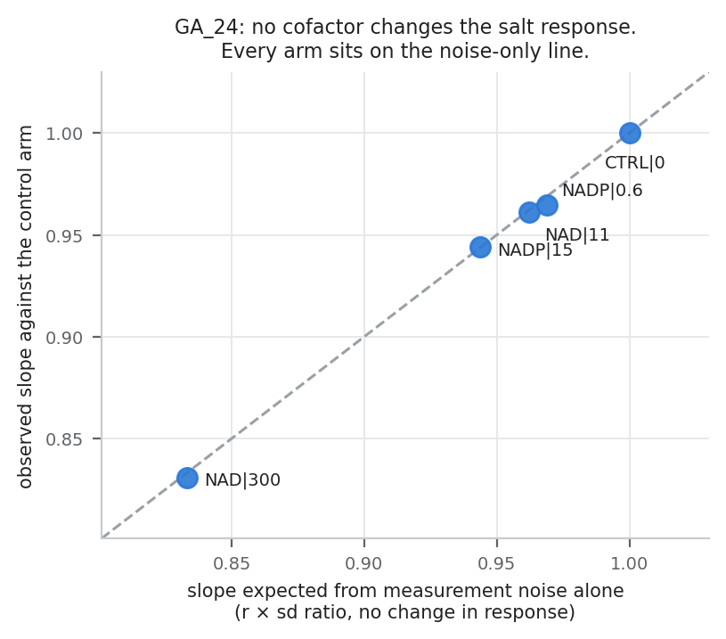
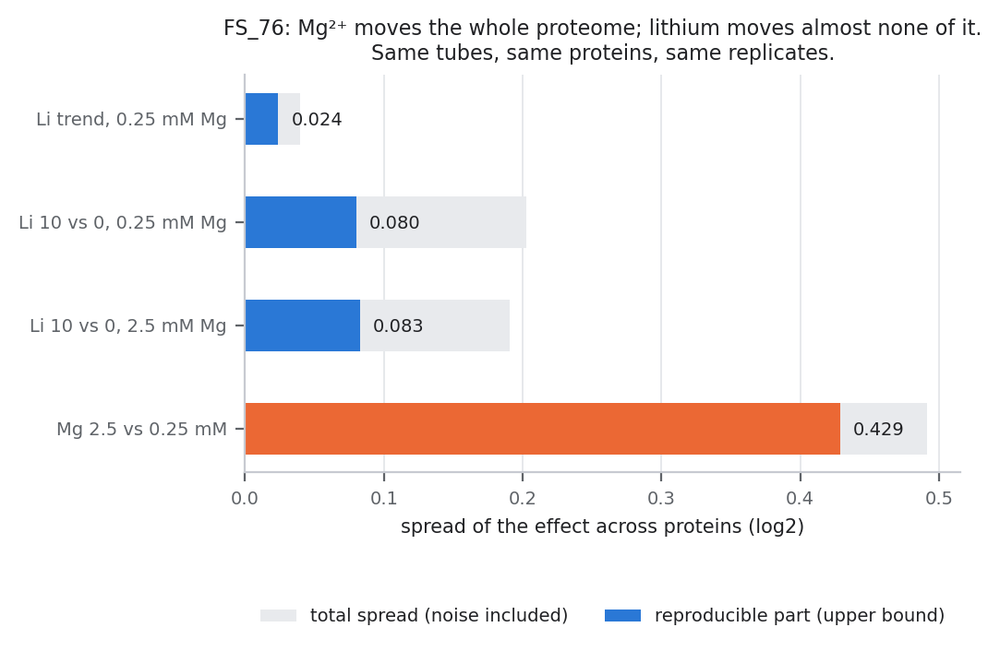
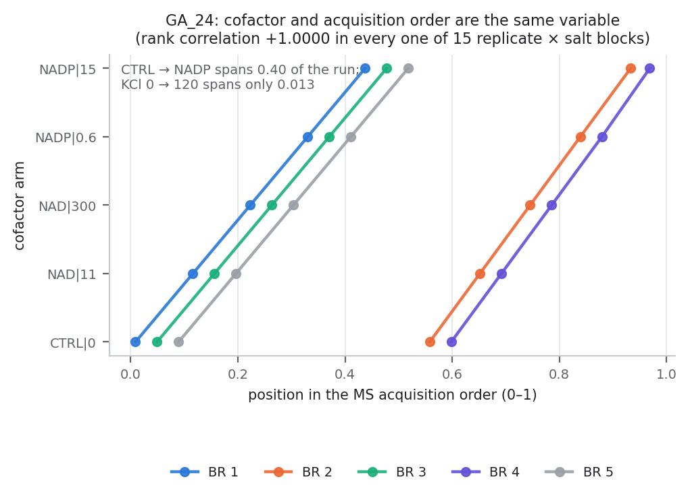
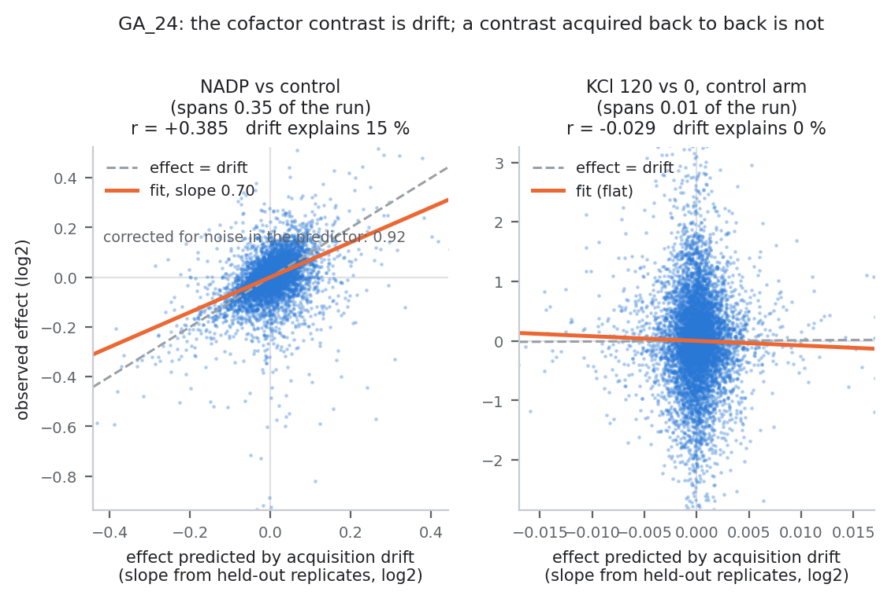

# 1. What the two experiments are

Both are HSPB1 pull-downs from lysate, and both crossed their perturbation with a second axis. That
crossing is what makes them readable, and in one case it is also what exposes a design fault.

| | FS_76 | GA_24 |
|------------|---------------------|---------------------------|
| Perturbation | Li⁺ 0 / 0.3 / 1 / 3 / 5 / 10 mM | NAD 11, 300; NADP 0.6, 15 (units not recorded) |
| Crossed with | Mg²⁺ 0.25 or 2.5 mM | KCl 0 / 60 / 120 mM |
| Biological replicates | 3–4 per cell, 44 samples | 5 per cell, 75 samples |
| Acquisition order | **not recorded** (proteoDA workbook) | recorded per sample (`inj_pos`) |

The campaign used only the perturbation-free arms of both runs, on the stated grounds that drug effects
would be "large and specific" and would dominate a proteome-wide model. That assumption is tested here
for the first time, and for lithium it is wrong in an interesting way: the effect is specific, but it is
not large in the sense of touching many proteins.

Throughout, an effect is reported as the spread of its per-protein values across the proteome, because
every run is median-normalised and absolute levels are therefore uninterpretable. Reliability is the
split-half value (replicates split in two, the two estimates correlated across proteins,
Spearman–Brown corrected), and it is quoted against a permutation null built by shuffling condition
labels **within** each replicate. At 37 °C one log2 unit is 0.427 kcal/mol.

# 2. What can be proven

## 2.1 Mg²⁺ reshapes the HSPB1 pull-down, and does so very reproducibly

Raising Mg²⁺ from 0.25 to 2.5 mM moves the proteome with a spread of 0.491 log2, reliability **0.983**
against a permutation null of 0.762 (p = 0.005), and 6,129 proteins at q < 0.05. The twenty strongest
hits measured +2.092 in the replicates that selected them and **+2.082** in replicates held out from
that selection, with every one of them keeping its sign. This is not a marginal effect being chased; it
is the positive control that makes the lithium result below interpretable, and it comes from the same
tubes, the same proteins and the same replicates.

The proteins involved are coherent. Ribosomal proteins fall furthest (−0.328 log2 relative to the rest,
cluster-bootstrap CI [−0.422, −0.241]), and so do proteins annotated as Mg²⁺-binding (−0.144
[−0.214, −0.075]), while NADP-binding proteins (+0.139 [+0.038, +0.237]), lyases (+0.105) and
transferases (+0.082) rise. Among individual proteins the mitochondrial ribosome is prominent
(MRPS12 −2.72, MRPS21 −1.66), as are DRG1 (−2.24) and its obligate partner ZC3H15 (−2.31), which move
together. A plausible reading — not tested here — is that 2.5 mM Mg²⁺ keeps ribosomes and
Mg²⁺-dependent assemblies intact so they do not come down with HSPB1, while 0.25 mM lets them dissociate.

## 2.2 Lithium moves three proteins, and they are one complex

Proteome-wide, lithium does nothing (section 3.1). Within that null sit three proteins that are not
noise: **GET4, UBL4A and BAG6 — the three obligate subunits of the BAG6 triage complex.** All three
leave the HSPB1 pull-down as lithium rises, monotonically across all six doses, by 1.2 to 1.4 log2
(a 2.3- to 2.7-fold loss, about 0.6 kcal/mol) at 10 mM Li⁺ in 0.25 mM Mg²⁺.

They clear four separate bars:

- **Monotone.** Spearman ρ of the dose profile against dose is −0.94 (GET4), −1.00 (UBL4A), −0.89 (BAG6).
- **Replicating.** Measured in disjoint halves of the replicates, GET4 gives (−0.29, −0.30), (−0.32, −0.30),
  (−0.28, −0.32); UBL4A and BAG6 are equally stable. No replicate carries the result.
- **Rare.** Only 7 of 8,516 proteins with a complete dose profile (0.08 %) are both monotone (|ρ| ≥ 0.9)
  and large (≥ 0.7 log2). Three of those seven are the BAG6 complex; one (LYZ) is a listed contaminant;
  the remaining three (AKR1B10, DUT, FABP5) do not survive the formal trend test (q ≥ 0.89, except DUT at
  q = 5 × 10⁻³ with no Mg interaction).
- **Mg-competitive.** This is the decisive one. Lithium is thought to act by competing with Mg²⁺, so a
  real lithium effect should weaken when Mg²⁺ is raised ten-fold. It does:

| | trend at 0.25 mM Mg²⁺ | trend at 2.5 mM Mg²⁺ | Li × Mg interaction |
|---|---|---|---|
| GET4 | −0.299 (q = 7 × 10⁻⁹) | −0.101 (q = 2 × 10⁻²) | −0.199 (q = 5 × 10⁻⁸) |
| UBL4A | −0.302 (q = 2 × 10⁻⁶) | −0.015 (q = 0.98) | −0.284 (q = 6 × 10⁻⁷) |
| BAG6 | −0.249 (q = 1 × 10⁻³) | −0.032 (q = 0.97) | −0.217 (q = 2 × 10⁻²) |

For UBL4A and BAG6 the effect is abolished outright at high Mg²⁺; for GET4 it is blunted but still
present, so "abolished" is accurate for two of the three and "weakened" for the third.

GET3, which works with this complex but is not part of it, shifts by only −0.081 and shows no Mg
interaction (q = 0.58) — so the effect tracks the complex, not the pathway.

### Where the effect sits, and where it does not

Three further checks narrow it. The first corrects how this section read on first writing.

**The BAG6 complex is not an enriched HSPB1 partner.** In the bound:free partition measured in GA_22 and
GA_24, BAG6 sits at the 11th and 17th percentile, UBL4A at the 20th and 20th, GET4 at the 38th and 20th —
all below the median, partitioning toward the free pool — while the bait itself is at the 88th and 85th.
The DNAJA1 and DNAJB11 enrichments agree (12th to 24th percentile). The three are abundant enough to
measure well, at the 70th to 80th percentile in the supernatant, but they are recovered roughly as
background rather than as captured partners. So *lithium disrupts an HSPB1–BAG6 interaction*, which is how
this result first read, is not supported. What is measured is how much BAG6 complex is recovered, and the
likelier reading is that lithium changes something about the complex itself — its integrity, or its
solubility in the lysate. Those partitions come from different lysates and buffers than FS_76, so they
constrain the interpretation rather than settling it.

**It is specific to lithium, not to being a drug screen.** FS_73 is the same bait, same lab, with three
unrelated anticonvulsants. At 100 µM none of them moves the complex — for GET4 / UBL4A / BAG6,
carbamazepine gives +0.048 / +0.190 / +0.023, lamotrigine +0.012 / +0.182 / −0.056, topiramate
+0.038 / +0.131 / −0.015, with every q ≥ 0.93 — against −1.2 to −1.4 log2 for lithium. The comparison is
not dose-matched, 100 µM of an organic molecule against 10 mM of an ion, so it says nothing about relative
potency. It says these three proteins do not simply wobble whenever something is added to an HSPB1
pull-down, and that they are detected stably enough for a null to mean something.

**The obvious mechanism is excluded.** GET3 — TRC40/ASNA1, the Mg²⁺-dependent ATPase that receives clients
from this very complex, and the textbook place for a Li⁺/Mg²⁺ competition — shifts by only −0.081 with no
Mg interaction. Whatever lithium is doing, it is not displacing Mg²⁺ at that nucleotide site.




## 2.3 No cofactor changes how the GA_24 pull-down responds to salt

The salt contrast (KCl 120 vs 0) is the one quantity in GA_24 that is immune to the acquisition problem
of section 3.3, because those two conditions were acquired back to back — 0.013 of the run apart. It can
be measured separately inside each of the five cofactor arms and compared.

Every arm reproduces the control arm's salt response: regression slopes 0.961 (NAD 11), 0.831 (NAD 300),
0.964 (NADP 0.6), 0.944 (NADP 15). The one apparent outlier, NAD 300, is not one. A slope below 1 has two
possible causes — a genuinely weaker response, or a noisier measurement — and pure attenuation predicts
slope = r × sd(arm)/sd(control) with no change in the underlying response. That prediction is 0.833 for
NAD 300 against 0.831 observed. Across all five arms the excess over the noise-only prediction is at most
0.004.



# 3. What can be discounted

## 3.1 A proteome-wide lithium effect

Six different lithium contrasts were measured, and every one of them has a reliability at or below its
own permutation null:

| Contrast | spread (log2) | reliability | null (95th pct) | p |
|---|---|---|---|---|
| Li trend, 0.25 mM Mg | 0.040 | 0.122 | 0.361 | 0.279 |
| Li trend, 2.5 mM Mg | 0.035 | −0.239 | 0.339 | 0.846 |
| Li 10 vs 0, 0.25 mM Mg | 0.202 | 0.079 | 0.156 | 0.375 |
| Li 10 vs 0, 2.5 mM Mg | 0.191 | 0.004 | 0.188 | 0.625 |
| Li trend, pooled | 0.024 | −0.022 | 0.783 | 0.478 |
| Li × Mg interaction | 0.047 | −0.023 | 0.761 | 0.478 |

The spread of the contrast is flat across doses — 0.199 to 0.220 at low Mg²⁺, 0.191 to 0.269 at high —
which is what a contrast made of noise looks like, and not what a dose-response looks like. Bounding the
reliability by its null bounds the reproducible between-protein spread at **≤ 0.080 log2 (0.034 kcal/mol)**
for the largest lithium contrast, against **0.429 log2 (0.183 kcal/mol)** for Mg²⁺ in the same samples: at
least five-fold smaller, and consistent with zero.



Section 2.2 is not in tension with this. Reliability measures whether a *profile across 8,500 proteins*
reproduces; three responders cannot move it. The two results together say: lithium is not a general
modifier of HSPB1 binding, and it has one specific target complex.

## 3.2 Lithium acting on its canonical targets in this assay

The named lithium-sensitive enzymes are flat. GSK3A −0.003 (q = 0.99), GSK3B +0.000 (q = 1.00),
IMPA1 +0.006 (q = 0.98), IMPA2 +0.014 (q = 0.97), INPP1 +0.023 (q = 0.97), BPNT1 +0.008 (q = 0.99).

This is not a detection failure, and that is the point worth keeping. The same proteins respond strongly
to Mg²⁺ in the same samples — INPP1 −1.459 (q = 4 × 10⁻¹⁸), BPNT1 −0.336, IMPA1 −0.298, IMPA2 −0.266,
GSK3B +0.113 — which is expected, since IMPA1/2, INPP1 and BPNT1 are precisely the Mg²⁺-dependent,
Li⁺-inhibited phosphomonoesterases that define lithium pharmacology. The assay sees this family clearly.
It reads their Mg²⁺ occupancy and not their lithium inhibition, which makes sense: what is measured is
how much of each protein co-precipitates with HSPB1, not whether its active site is blocked.

## 3.3 Any NAD or NADP effect read from the cofactor-versus-control contrast

The cofactor arms of GA_24 were acquired in a fixed order inside every block: control, NAD 11, NAD 300,
NADP 0.6, NADP 15. The rank correlation between cofactor arm and acquisition position is **+1.0000 in
every one of the 15 replicate × salt blocks**. Cofactor and acquisition slot are the same variable. Pairing
by replicate does not help, because the offset is identical in all five replicates.



A collinearity argument alone would only say the contrast is *unidentifiable*. The attribution test says
more. A drift slope can be estimated from a model that already carries a free mean for all 15 conditions,
so what identifies it is the position difference between replicates measured in the *same* condition —
cofactor-free by construction. Learned on one set of replicates and tested on the disjoint rest, that
slope predicts the apparent NADP-versus-control effect with r = +0.385 and a regression slope of 0.703,
which becomes **0.92 once corrected for the noise in the predictor** (the slope's own reliability is 0.762).
A slope of 1.0 means the apparent cofactor effect *is* the drift. For NAD versus control the corrected
slope is 0.82.

The test is not simply positive for everything: applied to the KCl 120 contrast, which spans 0.013 of the
run and is known to be real, drift predicts nothing (r = −0.029, R² = 0.001).



Two further observations point the same way. Adding a quadratic drift covariate cuts the NADP-versus-control
hits from 335 to 84 while leaving the salt contrasts untouched at 5,056. And the drift-immune cofactor
contrast — the cofactor × salt interaction of section 2.3 — is null to within 0.004.

## 3.4 The permutation null, for contrasts pooled across salt

A methodological correction that affects how the GA_24 numbers should be read. The relabelling null
shuffles the labels of every condition a contrast touches, so for a contrast pooled over salt it shuffles
salt levels in too. Salt is the largest effect in the run (spread 0.836 log2), so the null inherits its
variance and comes out at 0.77–0.89 — far too high to be a useful reference. Repeating each cofactor
contrast inside a single salt level fixes it: the nulls drop to 0.21–0.41. Any reading of the pooled
reliabilities against their pooled nulls, including the first pass of this analysis, is not informative.

# 4. What these data cannot decide

- **Whether a real NAD or NADP effect exists.** Within one salt level the dose contrasts do clear their
  (now clean) nulls — NAD 300 vs 11 at 0.461 against 0.205, NADP 15 vs 0.6 at 0.633 against 0.300 — and
  drift explains only 2 % of them. But dose and acquisition slot remain the same variable, and the
  attribution test rules out *smooth* drift, not a step artefact tied to a slot (carryover, autosampler
  position, prep order). The honest position is that something reproducible sits in those contrasts and
  it cannot be assigned to the cofactor from this design.
- **Whether the BAG6 result is itself an acquisition artefact.** FS_76 arrives as a proteoDA workbook with
  no acquisition order recorded, so the test of section 3.3 cannot be run on it. The Mg²⁺ dependence is the
  argument against it — a drift along the run does not switch off when the buffer changes — and that is
  strong, but it is an argument, not the direct check. **The acquisition order for FS_76 is worth asking
  the lab for; it would settle this.**
- **What the NAD and NADP concentrations are.** They are bare numbers (0.6, 11, 15, 300) with no unit in
  any file name, treated here as µM. If that is wrong the labels are still correct but no dose reading is.
- **Whether lithium reduces the complex's integrity or its abundance in the soluble pool.** Section 2.2
  argues the effect is on the complex rather than on an interface with the bait, but FS_76 measured only the
  pull-down — no supernatant, no input — so the free pool is unobserved. A supernatant fraction at each
  lithium dose would separate "less of it is soluble" from "less of it sticks", and it is the single most
  informative thing that could be added.
- **Whether the effect is direct.** These are lysate incubations, so an intermediary is not excluded.

# 5. What follows

1. **Randomise or counterbalance the condition order within each acquisition block.** This is the whole of
   the GA_24 problem and it costs nothing. The salt contrasts in that run are sound precisely because
   KCl 0 and 120 happened to run back to back; the cofactor arms are lost because they did not.
2. **Record the acquisition order for every run**, including those that arrive pre-processed. Without it
   the check in section 3.3 is unavailable, which is why the FS_76 caveat above cannot be closed.
3. **Follow the BAG6 result up directly, and collect the supernatant.** A lithium dose series with the
   supernatant kept at every dose, a bait-free control at each lithium concentration, and a finer Mg²⁺
   series would turn one specific and reproducible observation into a result. The Mg²⁺ competition is
   testable quantitatively: if it is ion competition, the half-effect lithium concentration should scale
   with Mg²⁺. The reciprocal pull-down on BAG6 would say whether HSPB1 is involved at all.
4. **Repeat the cofactor arms at a single salt with randomised order.** Four arms and a control at one salt,
   properly randomised, would answer in one run what the current design cannot answer at all.

# 6. Reproducing this

```
python code/cm28_lithium_cofactor.py     # contrasts, reliabilities, drift attribution
python code/cm28c_specific.py            # the responders, the Mg interaction, figure 6
python code/cm28b_figures.py             # figures 1-5
```

Outputs land in `data/campaign/cm28_lithium_cofactor.json`, `data/campaign/cm28_fs76_halves.npz` and
`reports/figures/arms/`. `cm28c` must run before `cm28b`, which reads what it writes.
