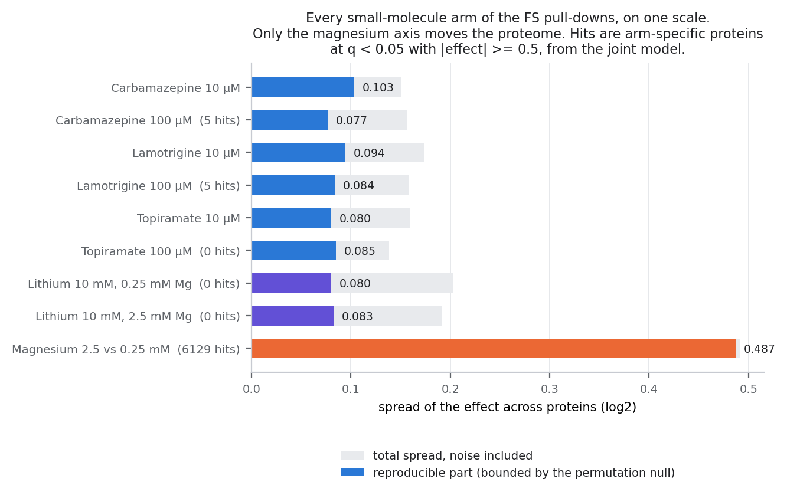
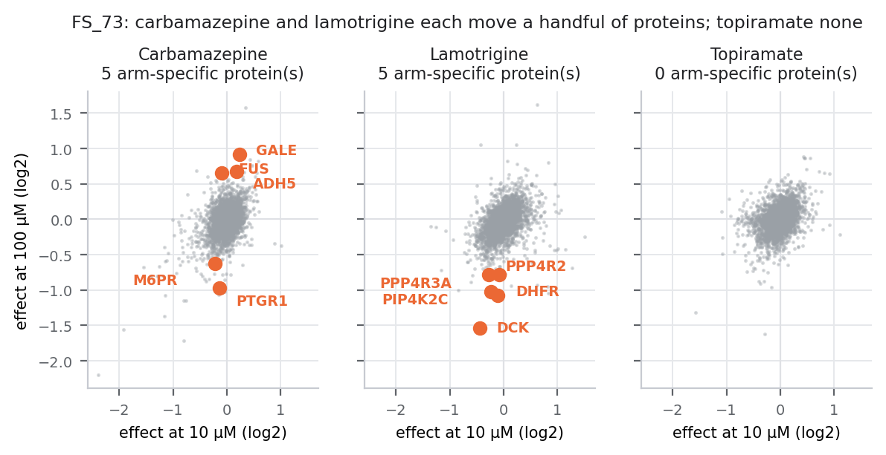
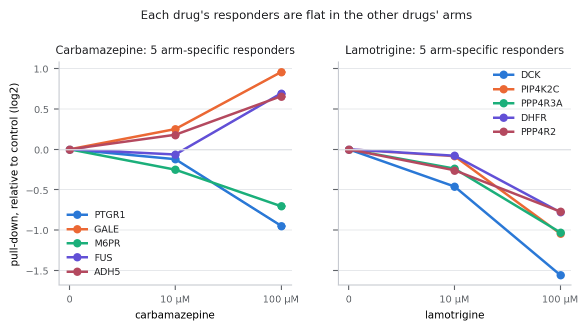
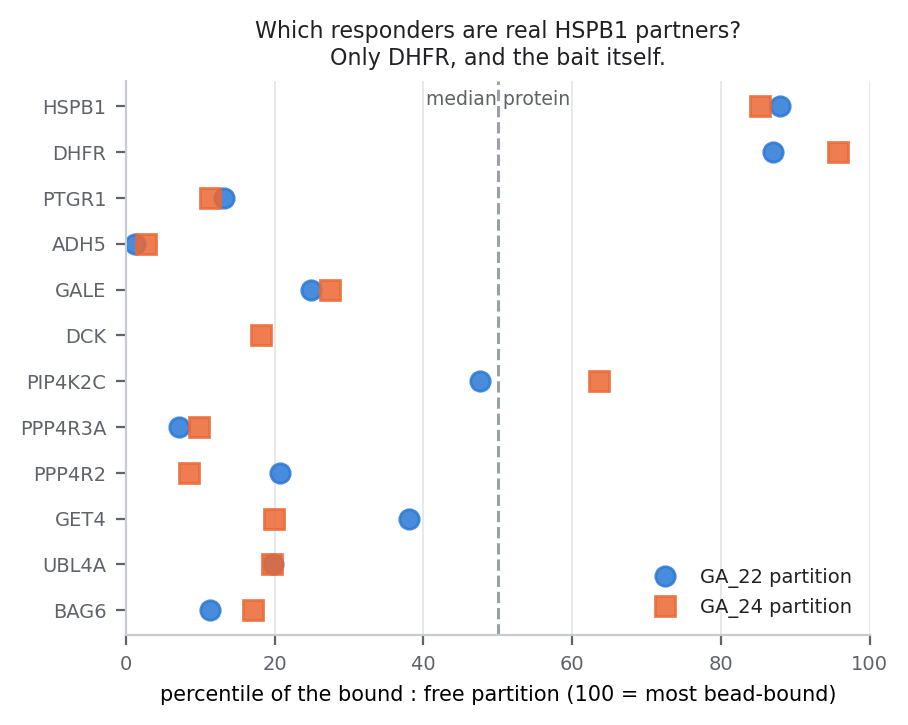
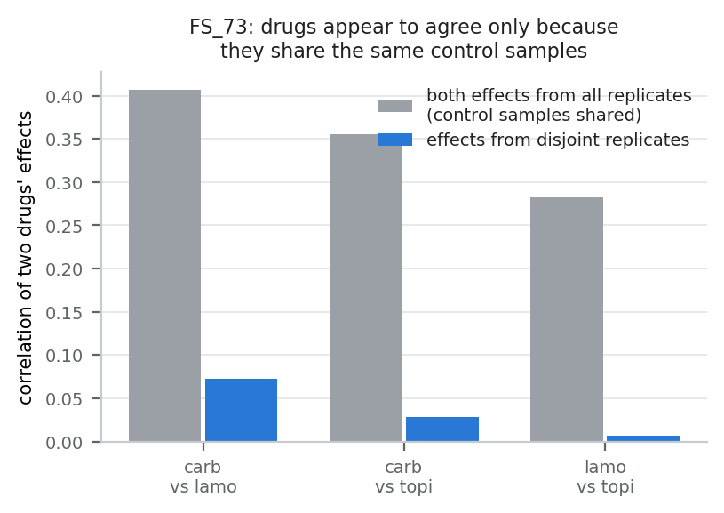

# 1. The screens, and how they were read

Two HSPB1 pull-downs at 37 °C carry small-molecule arms, and the campaign used neither.

| Run | Arms | Replicates | Proteins |
|---|---------------------------------------|--------------|----|
| FS_73 | carbamazepine, lamotrigine, topiramate, each at 10 and 100 µM, plus control | 4–6 BR per cell, 36 samples | 6,611 |
| FS_76 | Li⁺ 0 / 0.3 / 1 / 3 / 5 / 10 mM crossed with Mg²⁺ 0.25 or 2.5 mM | 3–4 BR per cell, 44 samples | 8,855 |

(The compound is spelled `lamotrigene` in the source workbook and therefore in the tables; it is lamotrigine.)

**The model.** One joint fit across all seven FS_73 conditions with a biological-replicate block, and
moderated t statistics with Benjamini–Hochberg across proteins. This matters more than it sounds. An
earlier pass fitted each drug contrast on only its own two conditions, which throws away the residual
degrees of freedom the other five arms carry: residual df falls from 24 to about 5, and carbamazepine
goes from five hits to none. **The null I first reported for carbamazepine was an artefact of that
choice, not a property of the drug.** It was caught by an independent re-analysis (§7).

**The battery.** Every contrast was put through the same checks, which are the accumulated list of ways
this project has been misled before:

- **Spread, never level** — both runs are median-normalised. At 37 °C one log2 unit is 0.427 kcal/mol.
- **Reliability against a permutation null computed inside the contrasted pair.** Relabelling a contrast
  that pools over another factor shuffles that factor in and inflates the null; in GA_24 that pushed nulls
  to 0.77–0.89 and made them useless.
- **Replication in held-out replicates,** and leave-one-BR-out, so nothing rests on one sample.
- **A per-protein hunt that does not depend on the profile reliability.** A reliability near zero means the
  6,611-protein *profile* is noise. It does not mean no protein responded, and in both runs some did.
- **Arm specificity:** a hit must be flat in the other two drugs' arms. This is the filter that does most
  of the work here.
- **Disjoint replicates wherever a shared term could manufacture agreement** — all six FS_73 contrasts
  share one control set (§5.1).
- **The bound:free partition,** to ask whether a responder is an enriched HSPB1 partner or background.

**Two things that are not available, and one that is weaker than it looks.** Neither FS run records MS
acquisition order, so the drift-attribution test that dismantled GA_24's cofactor arms cannot be run on
either; this is the largest hole in what follows. Replicate-sign unanimity is worthless as evidence here —
under label permutation the expected number of sign-unanimous proteins exceeds the observed number, so it
is free. And the original authors' fold changes, which ship in both workbooks, agree with mine at
r = 0.89–0.99 and are a good check **on point estimates only**: their reported p values reach 4 × 10⁻²⁰ on
five paired replicates, which is not attainable at four degrees of freedom, so their inference appears to
be run at precursor or injection level and their significance calls carry no independent weight.

# 2. What each drug moves



At the proteome level, four of the five arms do nothing: reliabilities sit at or below their permutation
nulls and no profile reproduces. Only magnesium moves the proteome. Everything interesting below is
individual proteins found inside those null profiles.

## 2.1 Carbamazepine — five proteins, three of them NAD(P) enzymes

| | 10 µM | 100 µM | q (100 µM) | lamotrigine | topiramate |
|---|---|---|---|---|---|
| PTGR1 | −0.138 | **−0.974** | 5 × 10⁻¹⁰ | +0.05 | +0.03 |
| GALE | +0.272 | **+0.953** | 2 × 10⁻³ | +0.15 | −0.03 |
| M6PR | −0.256 | **−0.716** | 7 × 10⁻³ | −0.03 | −0.15 |
| FUS | −0.058 | **+0.695** | 5 × 10⁻⁵ | +0.06 | −0.02 |
| ADH5 | +0.189 | **+0.665** | 3 × 10⁻⁷ | +0.17 | +0.04 |

All five are flat in both other drugs' arms. The strongest, PTGR1, is immovable: leave-one-BR-out keeps it
between −0.99 and −0.89, and across ten disjoint replicate splits both halves return −0.80 to −1.06.

**These five lean harder on the statistics than lamotrigine's do.** Carbamazepine has only four
biological replicates at 100 µM, and under an ordinary paired t-test with no variance shrinkage the
smallest BH q across the whole proteome is **0.479** — against 0.110 for lamotrigine. The joint model
reaches q = 5 × 10⁻¹⁰ for PTGR1 by borrowing variance across 6,611 proteins and using 24 residual degrees
of freedom rather than three. The effect sizes and the replicate-split stability do not depend on that
(§5.4), but the significance does, and more so here than anywhere else in this report.

Three of the five — **PTGR1** (prostaglandin reductase 1, an NADPH-dependent oxidoreductase), **ADH5**
(alcohol dehydrogenase 5 / S-nitrosoglutathione reductase, NAD-dependent) and **GALE** (UDP-galactose
4-epimerase, which carries a tightly bound NAD⁺) — are NAD(P)-binding enzymes. That is a coherent group
and it is not what a random draw of five proteins from this proteome looks like. It is an observation, not
a mechanism: carbamazepine has no NAD(P)-related pharmacology I can point to, and the three move in
different directions (PTGR1 down, ADH5 and GALE up), which a single shared mechanism would have to explain.

## 2.2 Topiramate — nothing, and this one is a real null

Zero proteins at q < 0.05 with |logFC| ≥ 0.5, at either dose. Reliability 0.100 and −0.314 against
permutation nulls of 0.250 and 0.377. Top-twenty replication +0.809 → +0.019 and +0.968 → −0.148, the
latter reversing sign.

This null is worth more than the ones in the first draft, because **topiramate has more replicates at
100 µM than carbamazepine does** — five against four — and still finds nothing where carbamazepine finds
five. It is not a power artefact relative to carbamazepine. It remains true that with four or five
replicates and 6,611 proteins, an effect much below 0.5 log2 would not be detected at all (§5.3).

## 2.3 Lamotrigine — five proteins, including a named target

| | 10 µM | 100 µM | q (100 µM) | carbamazepine | topiramate |
|---|---|---|---|---|---|
| DCK | −0.448 | **−1.543** | 3 × 10⁻¹⁵ | −0.03 | −0.06 |
| PIP4K2C | −0.137 | **−1.095** | 2 × 10⁻⁴ | +0.04 | −0.06 |
| PPP4R3A | −0.232 | **−1.021** | 1 × 10⁻¹⁴ | +0.01 | −0.01 |
| DHFR | −0.075 | **−0.774** | 1 × 10⁻⁹ | +0.06 | +0.01 |
| PPP4R2 | −0.252 | **−0.764** | 2 × 10⁻⁶ | −0.07 | +0.07 |

All five fall, all five are flat in both other arms, and in every disjoint replicate split both halves
return the same value (DCK stays within −1.39 to −1.70 across every split; the others are equally tight).
Arm specificity here is extreme: PPP4R3A's spread across the four arms of the other two drugs is 0.01.

**DHFR is a named target of lamotrigine.** The compound came out of a phenyltriazine antifolate programme
at Wellcome and inhibits dihydrofolate reductase in vitro, which is why it carries a teratogenicity
caution. Of the three drugs here, lamotrigine is the only one whose canonical target is a soluble cytosolic
enzyme a lysate pull-down could see at all (§5.2). But DHFR is the one hit with **no dose-response**:
−0.075 at 10 µM is indistinguishable from zero, and the entire effect appears at 100 µM. It behaves like a
threshold, not a titration, and it should not be presented as dose-dependent.

**PPP4R2 and PPP4R3A are the same PP4 subcomplex, and the split is clean.** PP4 forms two complexes sharing
a catalytic subunit: PP4c with PP4R2 and PP4R3A/B, and PP4c with PP4R1. Extending the readout separates
them — R2 −0.764 and R3A −1.021 respond, R3B shifts the same way at −0.249, the shared catalytic subunit
PPP4C moves about half as far at −0.363, and **PPP4R1, which belongs to the other complex, is flat at
+0.054**. A partial shift in the shared subunit and nothing in the other complex is what the complex
interpretation predicts. PPP4C, PPP4R3B and PPP4R1 do not individually reach significance, so this is a
consistent pattern rather than three more hits.

**It is not a pathway effect.** Around DHFR and DCK, nothing else moves: TYMS +0.135, MTHFD1 +0.022,
MTHFD2 +0.105, SHMT1 −0.083, SHMT2 +0.139, TK1 +0.031, UCK2 +0.090, ATIC +0.089, all q > 0.83, with only
GART at −0.220 (q = 0.03). And the five are not one co-varying module: after removing arm means their
pairwise residual correlation is 0.035, *below* the background among random protein pairs. Five
independently varying proteins agreeing is stronger than one module moving.

**The bait does not move.** HSPB1 is −0.101 under lamotrigine, −0.163 under carbamazepine and −0.020 under
topiramate at 100 µM, with the largest excursion anywhere being +0.232 at topiramate 10 µM. The other
chaperones present (HSPA8, HSPA1A, DNAJA1, DNAJB1, BAG3) are all within 0.13 of zero.





## 2.4 Lithium — the BAG6 complex, competitively with Mg²⁺

Covered in full in additional_text_11. Proteome-wide lithium is null. Inside that null, GET4, UBL4A and
BAG6 — the three subunits of the BAG6 triage complex — fall by 1.2–1.4 log2 monotonically across six
doses, identically in disjoint replicates, and ten-fold Mg²⁺ blunts or abolishes the effect. They are 3 of
only 7 proteins in 8,516 that are both monotone and large.

## 2.5 Magnesium — the whole proteome

Not a drug, but the ion axis of FS_76 and the only arm in either run that moves the proteome. Spread 0.491,
reliability **0.983** against a null of 0.763 (p = 0.003), **6,129 proteins at q < 0.05**, and the twenty
strongest hits measure +2.092 where they were selected and **+2.082** where they were not, every one
keeping its sign. The distribution is heavy-tailed, so the plain standard deviation overstates the typical
protein's shift: the robust equivalent (1.4826 × median absolute deviation) is 0.353.

This is what makes the nulls above meaningful. The same assay, the same bait, the same lab and — for
lithium — the same tubes detect a perturbation with near-perfect reproducibility.

## 2.6 The drug responses do not overlap

Each drug moves its own set and leaves the others' alone, which is the strongest argument that none of
these lists is just "proteins that wobble":

| | carbamazepine 100 µM | lamotrigine 100 µM | topiramate 100 µM | lithium trend |
|-------------------|------------|---------|--------|------------|
| PTGR1 / GALE / ADH5 / M6PR / FUS | **−0.97 … +0.95** | +0.05 … +0.17 | −0.15 … +0.04 | — |
| DCK / PIP4K2C / PPP4R3A / DHFR / PPP4R2 | −0.07 … +0.06 | **−1.54 … −0.76** | −0.06 … +0.07 | −0.03 … +0.00 (q ≥ 0.90) |
| GET4 / UBL4A / BAG6 | +0.02 … +0.19 (q ≥ 0.95) | +0.01 … +0.18 | −0.06 … +0.13 | **−0.30 … −0.25** |

All of these proteins are measured well in both runs, so the zeros are nulls and not absences. The one
protein that moves with several things is PPP4C, the shared PP4 catalytic subunit: −0.094 with lithium and
−0.765 with Mg²⁺. Magnesium moves nearly everything, including the bait at −0.349, so that axis carries no
specificity information.

# 3. A reading that fits part of this, and a test for it

HSPB1 binds clients with exposed hydrophobic surface — destabilised protein. A ligand that binds and
stabilises its target should therefore make that target *less* of an HSPB1 client and show up as a
**decrease** in recovery. DHFR, lamotrigine's named target, falls. That is the sign a target-engagement
assay would predict, and it would make this pull-down readable as a chaperone-capture analogue of a
thermal-shift experiment.

The honest limits of that reading: it covers one protein. Carbamazepine's five responders move in **both
directions** (+0.95 and +0.67 up, −0.97 and −0.72 down), which a simple stabilise-and-release model does
not explain, and DHFR's own response has no dose-dependence to fit an occupancy curve to. The idea is
worth testing — a finer lamotrigine series and a methotrexate competition would do it — but it is not
what the data currently show.

# 4. Which responders are real HSPB1 partners

A protein can respond without being a partner of the bait, because the pull-down also recovers background
in proportion to the free pool. The bound:free partition, measured in GA_22 and GA_24:

| | GA_22 partition | GA_24 partition | GA_33 enrichment (A1 / B11) |
|--------------|-------------|-------------|--------------------|
| HSPB1 (bait) | 88th | 85th | 82nd / 92nd |
| **DHFR** | **87th** | **96th** | 54th / 65th |
| DCK | — | 18th | 33rd / 46th |
| PPP4R3A | 7th | 10th | 22nd / 39th |
| PPP4R2 | 21st | 9th | 6th / 7th |
| GET4 / UBL4A / BAG6 | 38th / 20th / 11th | 20th / 20th / 17th | 15th / 14th / 12th |

**DHFR is the only responder in either run that is genuinely enriched on the beads**, at the 87th and 96th
percentile — comparable to the bait. For that one protein, "lamotrigine reduces HSPB1's capture of DHFR"
is supportable. For everything else, recovery is at or below the median, so the drug is more likely
changing something about those proteins themselves — their solubility, or their complex integrity — than
about an interface with HSPB1. The partitions come from different lysates and buffers than FS_73 and
FS_76, so they constrain the interpretation rather than settling it.



# 5. What can be discounted, and what cannot

## 5.1 The apparent agreement between drugs

At face value the drugs look alike: carbamazepine and lamotrigine at 100 µM correlate at r = +0.408 across
proteins, carbamazepine and topiramate at +0.355, lamotrigine and topiramate at +0.282. All six contrasts
are computed against **one shared set of control samples**, so noise in those controls enters every
contrast with the same sign. Recomputed from disjoint replicates — one drug from one subset of biological
replicates, the other from the complementary subset — the correlations collapse to +0.072, +0.028 and +0.006. (The independent re-analysis in §7, averaging
over a larger set of splits, puts the mean at +0.048; the conclusion is the same.)



Two qualifications, both from the independent check. The shared control inflates every pair but not
evenly — topiramate-100 against lamotrigine-10 reaches +0.474 while carbamazepine-10 against
lamotrigine-10 is only +0.082 — so "the shared controls explain the correlation" is too tidy a story for
the spread across pairs. More importantly, **the disjoint-replicate correlation should be read against a
ceiling, not against zero**: splitting a single drug's own profile across disjoint replicates gives a
self-consistency of only **+0.156 for lamotrigine, +0.011 for carbamazepine and −0.136 for topiramate**. Those profiles do not
replicate against themselves, so a near-zero cross-drug correlation was the only possible outcome and
carries no information about whether a shared drug response exists. The design conclusion stands — never
compare two FS_73 arms through their shared control — but the null is uninformative, not strong.

## 5.2 That the topiramate null says anything about topiramate

**None of the three drugs' canonical targets is present in these pull-downs:** 0 of 6 carbonic anhydrases
(topiramate), 0 of 7 voltage-gated sodium channel subunits (carbamazepine, lamotrigine), 0 of 6 GABA-A and
AMPA receptor subunits (topiramate). These are neuronal membrane proteins and this lysate has none of them.
So the correct statement is that topiramate changes nothing about what HSPB1 pulls down **in a preparation
that does not contain its targets** — a much weaker claim than "topiramate does nothing".

## 5.3 How small an effect would have been missed

Larger than one would like. With four or five biological replicates and BH across 6,611 proteins, an
effect of about 1.0 log2 sits near the detection edge. The direct demonstration: refitting lamotrigine
after deleting one replicate, so it has the same four that carbamazepine has, drops it from five hits to
one — only DCK, at 1.5 log2, survives, while PPP4R3A goes from q = 0.007 to 0.079 and DHFR from 0.014 to
0.093. Any arm could be hiding effects below roughly 0.6 log2 and this design would not see them.

## 5.4 That the hit calls are robust to the choice of test

They are not, and this should be said plainly. The hits above require **empirical-Bayes moderation** of the
per-protein variance. Under an ordinary paired t-test with no variance shrinkage, lamotrigine at 100 µM
yields **zero** proteins at q < 0.05: the raw p values for the five are 2.4 × 10⁻⁵ to 8.6 × 10⁻⁵, which BH
across 6,611 proteins turns into q = 0.110. The same is true of every arm — the smallest unmoderated q
anywhere is 0.479 for carbamazepine, 0.110 for lamotrigine and 0.083 for topiramate, so **no arm in this
screen produces a hit without variance moderation.** The *effect sizes* are not in question — they are identical
under every estimator tried, including a within-replicate paired difference that agrees with the
least-squares fit to machine precision — and the disjoint-replicate stability is estimator-free. But
"significant at q < 0.05" here means "under a moderated t-test", and it should be written that way.

# 6. What cannot be decided here

- **Whether any of this is acquisition drift.** Neither FS run records injection order. For lithium the
  Mg²⁺ dependence argues against it; for the FS_73 hits the argument is only arm specificity — a drift
  along the run would not pick five proteins in one arm and leave 6,606 alone — which is suggestive and
  not a test.
- **Why carbamazepine moves three NAD(P) enzymes, in two directions.**
- **Whether DHFR falls because lamotrigine stabilises it.** A folate or methotrexate competition would show it.
- **What DCK and PIP4K2C are doing.** The two largest FS_73 effects, and no pharmacology for either.
- **Whether lamotrigine redistributes PP4c between its two complexes.** §2.3 is consistent with it, but
  PPP4C's own shift does not reach significance.

# 7. The independent check

Every claim here was re-derived by a second analysis working only from the exported flat tables, with its
own implementation of the linear model, empirical-Bayes moderation and BH correction, and no access to the
code above. Effect sizes, spreads, the four-to-five hit identities, their stability under replicate
deletion, the shared-control correlation and its collapse, and the FS_76 nulls all reproduced.

Five things it found that were wrong or overstated, all of which are corrected above:

1. **Carbamazepine was reported as null.** It is not; the null came from fitting each contrast on its own
   two conditions. This is the substantive correction, and it changed a headline.
2. **The hit calls depend on variance moderation** (§5.4). The first draft said "significant" unqualified.
3. **The carbamazepine and topiramate nulls were partly a power statement** and were written as if they
   were a statement about the drugs (§5.3).
4. **The cross-drug null has no headroom** — those profiles do not replicate against themselves (§5.1).
5. **Smaller items:** the bait's largest excursion is +0.232 at topiramate 10 µM, not under 0.2; the Mg
   spread is tail-driven and the robust value is 0.353; PIP4K2C is a fifth lamotrigine hit, so "exactly
   four" was a threshold accident; and the published q values are not usable as an independent check.

It also flagged six weak topiramate candidates (SURF6, TM2D3, AGPAT4, CA5B, C16orf87, SLC36A1) under a
looser criterion. They are all small and all negative, which looks more like a mild arm-level offset than
pharmacology, and none passes the bar used here. They are recorded rather than claimed.

# 8. What follows

1. **More replicates before more conditions.** Five is not enough to see a 0.5 log2 effect across 6,600
   proteins, and that is the binding constraint on every arm in this screen.
2. **A finer lamotrigine dose series** — 1, 3, 10, 30, 100, 300 µM — on DCK, PIP4K2C and DHFR. DHFR's
   threshold behaviour versus DCK's graded response is the most informative difference to resolve.
3. **A folate or methotrexate competition** against lamotrigine, to test the ligand-stabilisation reading.
4. **Confirm the PP4 split directly:** immunoprecipitate PP4c under lamotrigine and blot for R1 against
   R2/R3A.
5. **Record the MS acquisition order** for every run, including those processed upstream.
6. **Keep the supernatant.** For every responder that is not bead-enriched — all of them except DHFR — the
   free pool is what separates "less soluble" from "less bound".

# 9. Reproducing this

```
python code/cm29_fs_drugs.py      # contrasts, joint-model hit calls, reliabilities, cross-drug, partitions
python code/cm29b_figures.py      # figures 1-5
```

Outputs: `data/campaign/cm29_fs_drugs.json`, `data/campaign/cm29_fs_vectors.npz`,
`reports/figures/fsdrugs/`.
